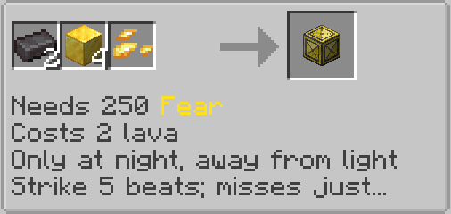
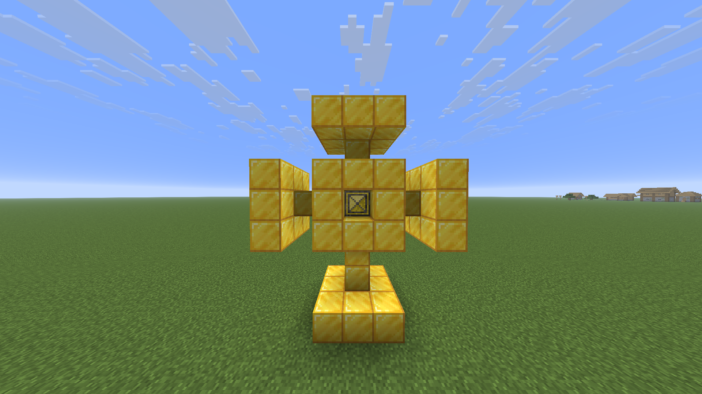

# What Does the Fear Power Battery Look like?

The Fear Battery is made out of Gold Blocks with a Yellow Core in the middle.

Yellow Battery Core Recipe:

"Needs 250 Fear

Costs 2 lava

Only at night, away from light

Strike 5 beats; misses just retry the strike"

# How do I build it?

The Fear Battery is constructed as such, though fully encased:

