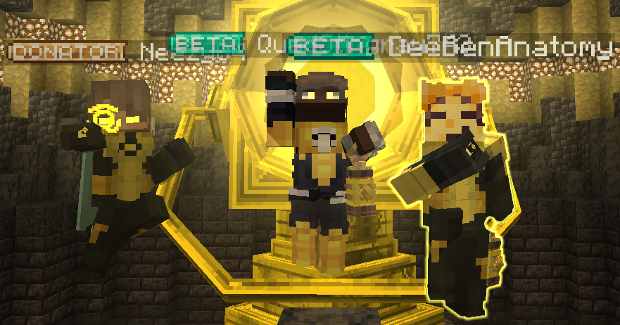
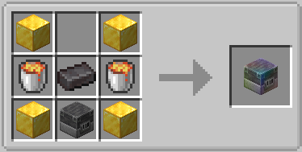
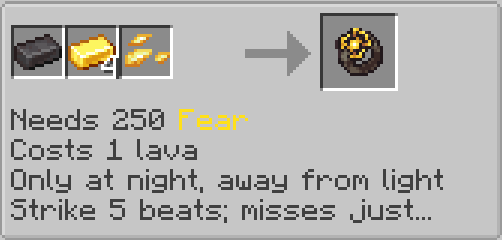
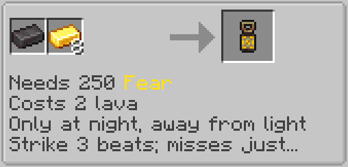
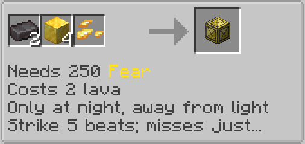

# Yellow items are made using a Spectrum Forge Block. This is **needed** to forge the corps items such as a ring.
# it also requires parallax shards which can be found in anceint city chests or obtained by killing wardens.

## This page talks about the emotional spectrum(see: default kebind is K)

The Yellow (Fear) Ring can be obtained as such:

- Craft a Spectrum Forge. You need 250 Fear to start forging, and forging can only be performed at night.
- Get the correct materials for the ring and lantern. See materials by shift right-clicking the block, it will list the required materials on-screen.
- Complete the minigame to forge your ring and lantern. You can complete the minigame by left or right clicking in time with the visual

Like any other ring, you will need to construct a Yellow Power Battery before your yellow ring may be used. Note that in order to provide lava for the recipes, you must right-click the Spectrum Forge with a bucket of lava.

Recipe for crafting a Spectrum Forge:

Recipe for Yellow Ring:

Recipe for Yellow Lantern:

Recipe for Yellow Core:

## How do I get Fear?

- Kill mobs while sneaking or invisible
- Kill mobs who are slowed or weakened
- Hurt passive mobs
- Hurt players or mobs that are not looking at you
- Kill players or mobs that are injured, fleeing, or panicking

## Available Abilities
| Innate Ring Abilities | Has Ability |
| -------- | -------- |
| Tractor Beam | Yes |
| Comms | Yes |
| Concussive Blast | Yes |
| Scan | Yes |

| Combat Ability | Has Ability |
| -------- | -------- |
| Blast | Yes |
| Swarm Missiles | Yes |
| Piercing Lance | Yes |
| Chain Bolt | Yes |
| Boomerang Disc | Yes |
| Rapid Barrage | Yes |
| Nova Burst | Yes |
| Ground Slam | Yes |
| Plasma Burst | No |
| Crystal Prison | No |
| Gravity Ball | Yes |
| Gravity Repulsor | Yes |

| Misc. Construct | Has Ability |
| -------- | -------- |
| Beam | Yes |
| Healing Beam | No |
| Hand | Yes |
| Forge | Yes |
| Blood Hunt | No |
| Magnet | Yes |

| Shield Construct | Has Ability |
| -------- | -------- |
| Bubble Shield | Yes |
| Dome Shield | Yes |
| Bulwark | Yes |
| Containment Sphere | Yes |

| Utility Construct | Has Ability |
| -------- | -------- |
| Glider | Yes |
| Grappling Hook | Yes |
| Light Orb | Yes |
| Lumberjack | Yes |
| Ring Compass | Yes |
| Ore Finder Probe | No |
| Megaphone | Yes |
| Horse | Yes |
| Boat | Yes |

| Drill Constructs | Has Ability |
| -------- | -------- |
| Hold | Yes |
| Tunnel | Yes |

| Weapon Construct | Has Ability |
| -------- | -------- |
| Turret | Yes |
| Energy Whip | Yes |
